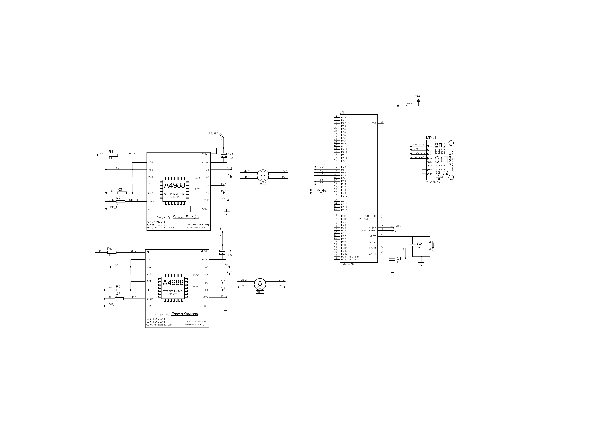

## Source code for a simple university project - self-balancing robot.

The schematic doesnt include the power source connections.

Utilized power supply components:

 3× Li-ion cells (12.7 V nominal) → 3S Li-ion Battery Management System (BMS) rated at 8 A → 12.7 V to 5 V step-down DC-DC converter → 5 V to 3.3 V Low Dropout Regulator (LDO) model TLV75533PDBVR.

 BMS output should feed the motors and the Step-down converter. Additionaly you could add an LED to observe the current functioning state.
 Step-down output should feed A4988-s & LDO.

 3.3V should feed the MCU and the gyro/accelerometer.

You may need to add a button to awake the BMS between one of OUT and one of 12.7V lines. Select the polarity (positive or negative) that is not directly shorted to the corresponding power source terminal, ensuring connection to the matching polarity on the battery source.

